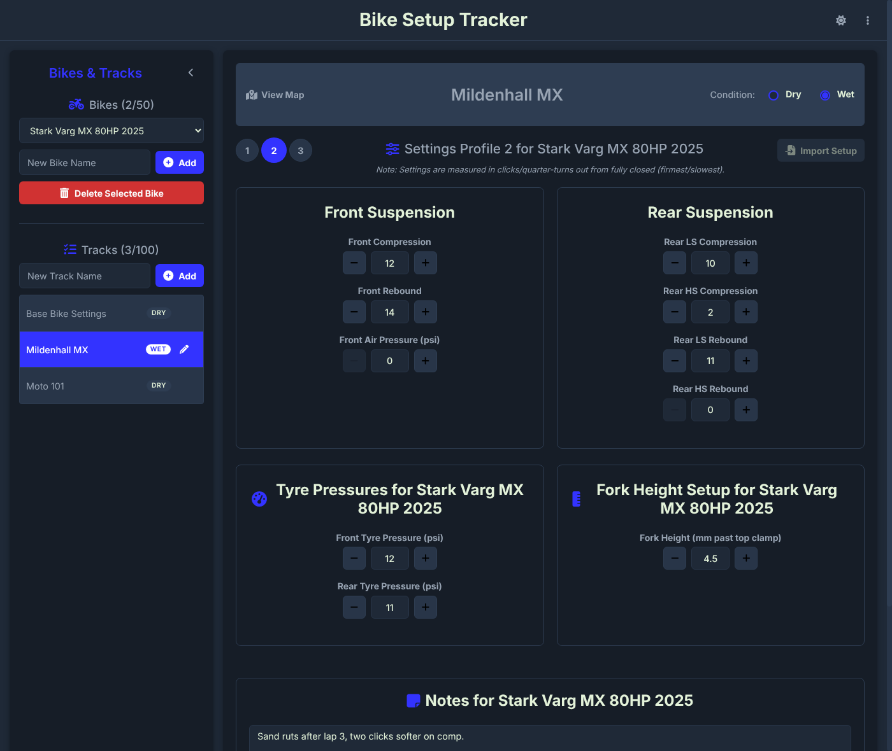
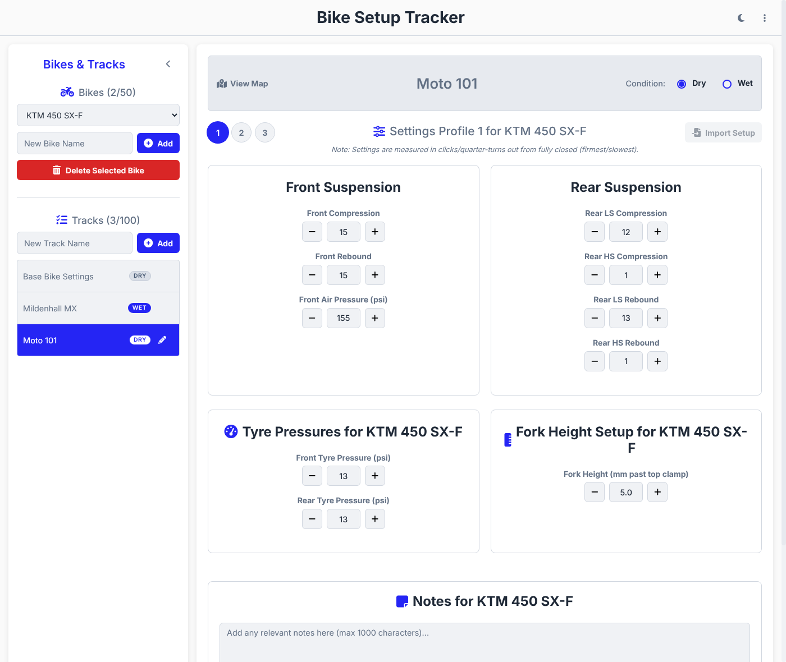
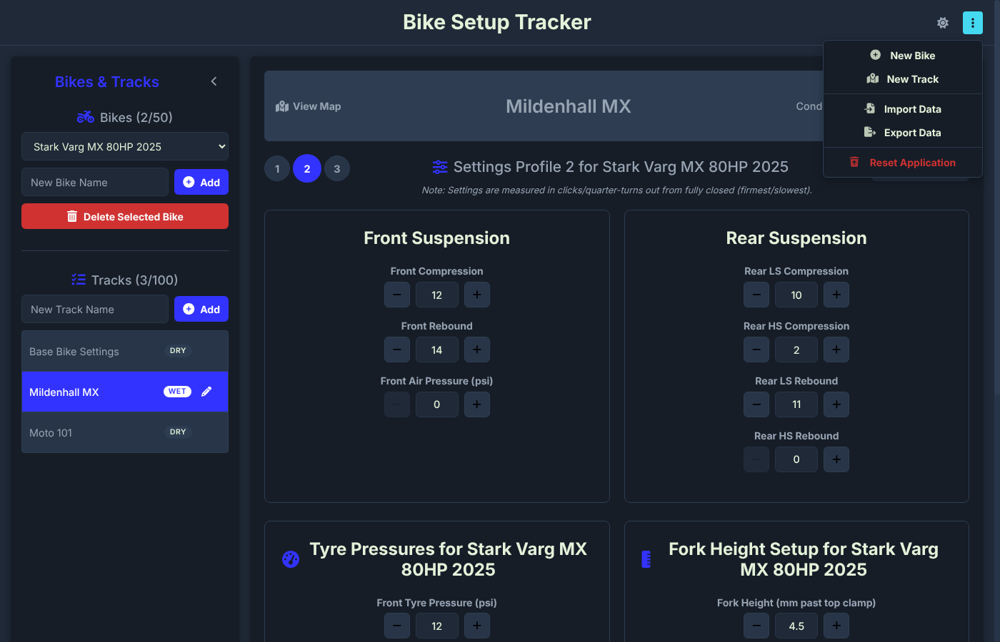

<div align="center">



# Bike Setup Tracker

**Record, organise and compare your motocross suspension and tyre settings for every bike, every track and every condition.**

Available for **Android** and **Windows**, and your setups move between them in one small file.

*Set it up. Track it. Ride it.*

[Thanks](#thanks-and-accreditation) · [What it does](#what-it-does) · [Downloads](#downloads) · [Install](#installing) · [Using the app](#using-the-app) · [Phone ↔ PC](#moving-your-setups-between-phone-and-pc) · [Building](#building-from-source) · [License](#license)

</div>

---

## Thanks and accreditation

- **[Google AI Studio](https://aistudio.google.com)**: Bike Setup Tracker was vibe coded in Google AI Studio, with Google's Gemini models writing the app from my direction, ideas and testing. The screens, the setup tracking and the Android app all started there. See [Made with AI](#made-with-ai).
- **[Anthropic's Claude](https://claude.ai/code)**: the AI coding assistant that turned the app into a Windows desktop program, kept its files compatible with the Android app, and wrote this page, working from my requests.
- **[Capacitor](https://capacitorjs.com)** (MIT) packages the app for Android.
- **[Electron](https://www.electronjs.org)** and **[electron-builder](https://www.electron.build)** (MIT) package the app for Windows.
- **[Font Awesome Free](https://fontawesome.com)** for the icons (icons CC BY 4.0, fonts SIL OFL 1.1, code MIT).
- **[Inter](https://rsms.me/inter/)** by Rasmus Andersson for the typeface (SIL OFL 1.1), bundled through [Fontsource](https://fontsource.org).
- **[Vite](https://vitejs.dev)**, **[TypeScript](https://www.typescriptlang.org)** and **[Vitest](https://vitest.dev)** for building and testing.

## A hobby project, offered as-is

This is a hobby project, made for fun in spare time. It is offered **as-is, with no warranty, no support and no promised updates.** There may be bugs, and some may never be fixed. Issues are turned off on this repository and I'm not able to answer questions, take requests or fix problems. You're welcome to use it, learn from it and change it for your own use under the terms of the [license](LICENSE), at your own risk. Back up anything you care about: use **Export Data** now and then and keep the file somewhere safe.

The settings you record are your own notes. Always check your bike's settings against the manufacturer's manual, and ride safely.

## What it does

Spend less time trying to remember your last suspension adjustments and more time concentrating on your riding.

- 🏍️ **Manage multiple bikes.** Up to 50 bike profiles, each with its own settings.
- 🏆 **Track your favourite circuits.** Up to 100 tracks, each with an optional map link that opens in your browser or maps app.
- 🌦️ **Dry and wet conditions.** Every track keeps a separate dry setup and wet setup, and remembers which condition you last used.
- 📋 **Three setup profiles.** Profiles 1, 2 and 3 for every bike, track and condition, so you can keep a baseline and two experiments side by side.
- 🔧 **Detailed suspension settings**, adjusted with − and + buttons (hold a button down to change the value quickly):
  - Front fork compression and rebound
  - Front fork air pressure
  - Rear low-speed and high-speed compression
  - Rear low-speed and high-speed rebound
  - Front and rear tyre pressures
  - Fork height, to 0.1 mm
- 📝 **Setup notes.** Up to 1,000 characters per setup for adjustments, observations and reminders for next time.
- 📂 **Copy and reuse setups.** *Import Setup* copies a setup from another track, condition or profile of the same bike, so you can start from one that already works.
- 💾 **Unsaved-change protection.** The app asks before you move away from a setup with unsaved changes, and lets you save or discard them.
- 🌙 **Dark and light themes.** Dark for the garage, light for bright sunshine at the track.
- 🔒 **Private and offline.** No account, no internet connection, no adverts. Everything is stored on your own phone or PC.
- 🔄 **Backup and transfer.** *Export Data* saves everything to one file that you can keep as a backup or open on another device, Android or Windows.

<div align="center">


</div>

## Downloads

Download from the [**Releases**](../../releases/latest) page. The app comes in three forms:

| Download | For | What it is |
| --- | --- | --- |
| 📱 **`Bike-Setup-Tracker-v2.apk`** | Android phones and tablets | The Android app. Install it once and it appears in your app drawer. |
| 💿 **`Bike-Setup-Tracker-Setup-2.0.0.exe`** | Windows 10 and 11 (64-bit) | The Windows **installer**. It installs the app, adds Start menu and desktop shortcuts, and can be uninstalled from Windows Settings. Best when the app will live on one PC. |
| 🔌 **`Bike-Setup-Tracker-2.0.0-portable.exe`** | Windows 10 and 11 (64-bit) | The **portable** Windows app. One file that runs without installing anything. Good for a USB stick, a shared PC, or just trying it out. |

All three are the same app with the same features, and they all read and write the same backup files.

Builds from when the app was called Suspension Tracker (V1 to V3) are kept in the [`legacy`](legacy) folder.

## Installing

### 📱 Android (APK)

1. On your phone, download **`Bike-Setup-Tracker-v2.apk`** from the Releases page.
2. Open the downloaded file from your browser's downloads or the Files app.
3. The first time, Android asks you to allow installs from that app. Tap **Settings**, turn on **Allow from this source**, then go back.
4. Tap **Install**. If Google Play Protect says it doesn't recognise the app, tap **More details**, then **Install anyway**. It warns because the app doesn't come from the Play Store.
5. Open **Bike Setup Tracker v2** from your app drawer.

To update, install the newer APK over the top and your bikes, tracks and setups are kept. Export a backup first to be safe.

### 💿 Windows installer (Setup .exe)

1. Download **`Bike-Setup-Tracker-Setup-2.0.0.exe`** from the Releases page.
2. Double-click it. Windows may show **"Windows protected your PC"** because the app isn't digitally signed. Click **More info**, then **Run anyway**.
3. Choose whether to install for just you or for everyone on the PC, pick a folder or keep the default, and click **Install**.
4. Start **Bike Setup Tracker** from the Start menu or the desktop shortcut.

To update, run the newer installer and your data is kept. To remove the app, go to **Settings → Apps → Installed apps → Bike Setup Tracker → Uninstall**.

### 🔌 Windows portable (.exe)

1. Download **`Bike-Setup-Tracker-2.0.0-portable.exe`** from the Releases page.
2. Put it wherever you like: the Desktop, Documents, or a USB stick.
3. Double-click it to run. The first time, Windows may show **"Windows protected your PC"**. Click **More info**, then **Run anyway**.

Nothing is installed. Each time it starts, the portable version unpacks itself to a temporary folder, so it takes a few seconds longer to open than the installed version. To remove it, delete the file.

On the same PC, the installed and portable versions share the same saved data. On a different PC the portable version starts empty, so use **Export Data** and **Import Data** to take your setups with you.

### Where your data is kept

| Version | Location |
| --- | --- |
| Android | In the app's private storage on the phone. It is removed if you uninstall the app or clear its data. |
| Windows (both versions) | In `%APPDATA%\Bike Setup Tracker` on that PC. Uninstalling or deleting the app doesn't remove it. |

Backups made with **Export Data** are ordinary files that you keep wherever you like.

## Using the app

### First steps

1. **Add a bike.** In **Bikes & Tracks** on the left, type the bike's name in *New Bike Name* and click **Add**. Switch between bikes with the drop-down list.
2. **Add a track.** Type its name in *New Track Name* and click **Add**. Click the ✏️ pencil on a track to rename it or add a map link, such as a Google Maps link. **View Map** then opens it.
3. **Pick the track and condition.** Click a track in the list, then choose **Dry** or **Wet** at the top. The DRY or WET badge in the list shows which one each track is on.
4. **Pick a profile.** Use the **1**, **2** and **3** buttons. Each profile is a separate setup for this bike, track and condition.
5. **Enter your settings.** Use **−** and **+**, and hold a button down to change the value faster. Add notes in the box at the bottom.
6. **Save.** Click **Save Profile 1 Settings** (the number matches the profile you're on).

New Bike and New Track are also in the **⋮** menu at the top right. Click **‹** in the side panel's header to collapse it and give the settings more room.

### Settings explained

| Setting | Range | Notes |
| --- | --- | --- |
| Front compression and rebound | 0 to 40 | Clicks out from fully closed (firmest or slowest) |
| Front air pressure | 0 to 200 psi | For air forks. Leave at 0 for spring forks |
| Rear low-speed and high-speed compression | 0 to 40 | Clicks or quarter-turns out from fully closed |
| Rear low-speed and high-speed rebound | 0 to 40 | Clicks or quarter-turns out from fully closed |
| Front and rear tyre pressure | 0 to 30 psi | |
| Fork height | 0 to 50.0 mm | How far the fork tubes stand above the top clamp |
| Notes | Up to 1,000 characters | Anything else: sag, gearing, how the bike felt |

### Copying a setup (Import Setup)

**Import Setup**, above the settings, copies a setup from another track, condition or profile **of the same bike** into the one you're looking at. Choose the source track, Dry or Wet, and the profile, then click **Import**. Check the values and save to keep them. The button is greyed out until the bike has at least one saved setup to copy from.

### Themes

Click the ☀️ or 🌙 button at the top right to switch between dark and light. The app remembers your choice.

### Backing up and resetting

The **⋮** menu at the top right has:

- **Export Data** saves all bikes, tracks, setups and notes to one file, `suspension_tracker_backup_YYYYMMDD.json`. On Android it goes to your **Documents** folder. On Windows you choose where to save it, starting in Documents.
- **Import Data** loads a backup file. **It replaces everything currently in the app**, so export first if you want to keep what's there. On Windows you can also drag a backup file onto the app window.
- **Reset Application** deletes all data and starts again with the example bike and tracks. It can't be undone.

## Moving your setups between phone and PC

Every version uses the same backup file, so setups can go either way.

**Phone → PC**

1. On the phone, open the **⋮** menu and choose **Export Data**. The file is saved to **Documents**.
2. Copy the file to the PC by USB cable, email, Google Drive, OneDrive or Nearby Share.
3. In the Windows app, choose **⋮ → Import Data** and pick the file, or drag it onto the window.

**PC → phone**

1. In the Windows app, choose **⋮ → Export Data** and save the file.
2. Copy it to the phone.
3. On the phone, choose **⋮ → Import Data** and pick the file.

Backups from the older Suspension Tracker V1 to V3 apps can be imported too. Their setups go into Profile 1.

## Made with AI

Bike Setup Tracker was vibe coded: written by AI from my direction rather than typed by hand.

- **The app itself** (the screens, the setup tracking, the profiles and notes, the themes and the Android build) was created in **Google AI Studio** with Google's Gemini models, from my ideas, requests and testing.
- **The Windows version** (the Electron desktop app, the Windows file dialogs, the shared backup format, the tests and this page) was built with **Anthropic's Claude** as a coding assistant, again from my requests.

## Building from source

You need [Node.js](https://nodejs.org) 22 or newer.

```sh
npm install
npm test           # checks the backup file format against an Android export
npm start          # builds and runs the desktop app
npm run dist:win   # builds both Windows .exe files into the release folder
```

`npm run dist:win` works on Windows as it is. On Linux or macOS it also needs [Wine](https://www.winehq.org). Every push to GitHub builds both `.exe` files on a Windows machine with GitHub Actions ([`build-windows.yml`](.github/workflows/build-windows.yml)), and you can download them from the workflow run's *Artifacts*.

### Project layout

| Path | What it is |
| --- | --- |
| [`src/shared/schema.ts`](src/shared/schema.ts) | The backup file format in one place: types, limits, defaults, validation (`parseBackup`) and writing (`serializeBackup`). Change the format here and nowhere else. |
| [`src/renderer/`](src/renderer) | The app's screens, from the Google AI Studio app (`app.ts`, `index.css`) |
| [`electron/`](electron) | The Windows desktop shell: the window, the Open and Save dialogs, and opening map links in your browser |
| [`test/`](test) | Backup format tests and a sample Android backup |
| [`docs/images/`](docs/images) | Screenshots for this page |
| [`legacy/`](legacy) | APKs of the older Suspension Tracker V1 to V3 |

## License

[MIT](LICENSE). You're free to use, copy, change and share it, including commercially, as long as the copyright and license notice are kept. It comes with no warranty. See the [license file](LICENSE) for the full terms.

<div align="center">

© GizMX Racing Development

</div>
